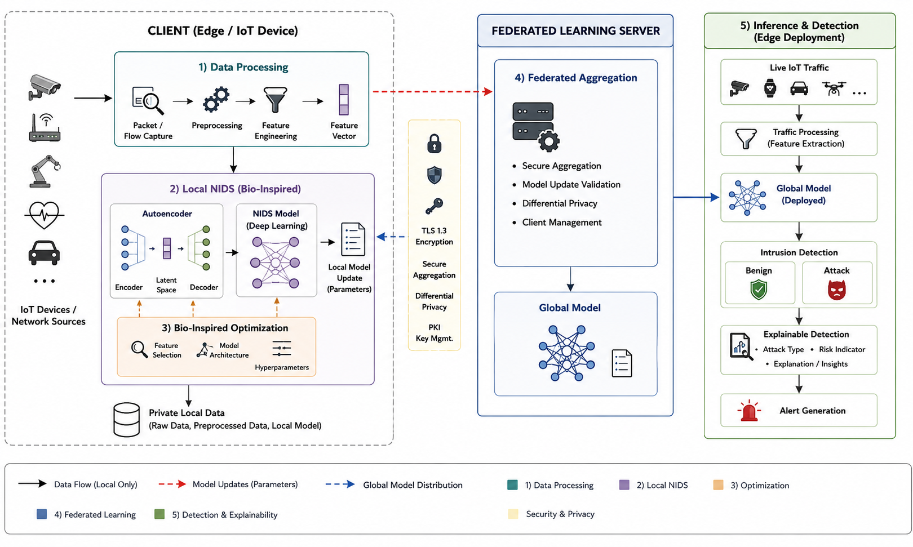
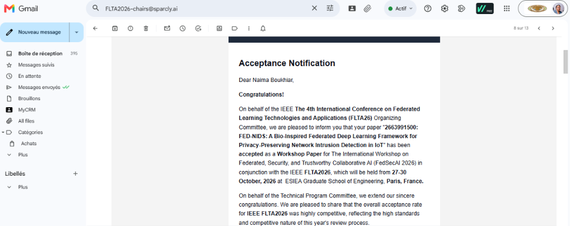
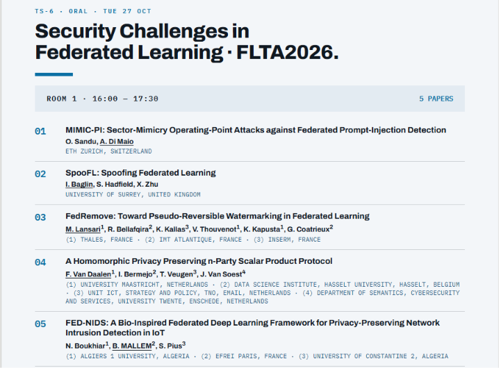
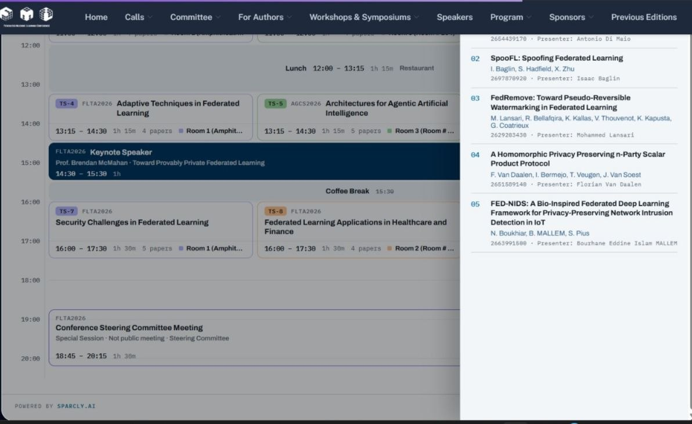
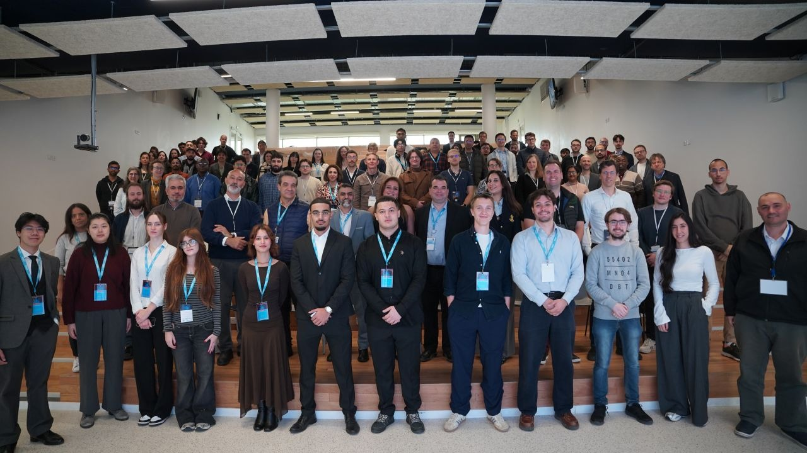
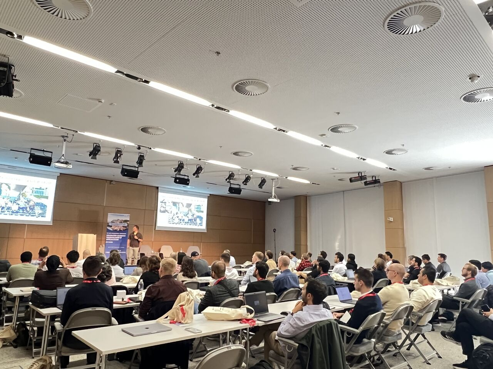
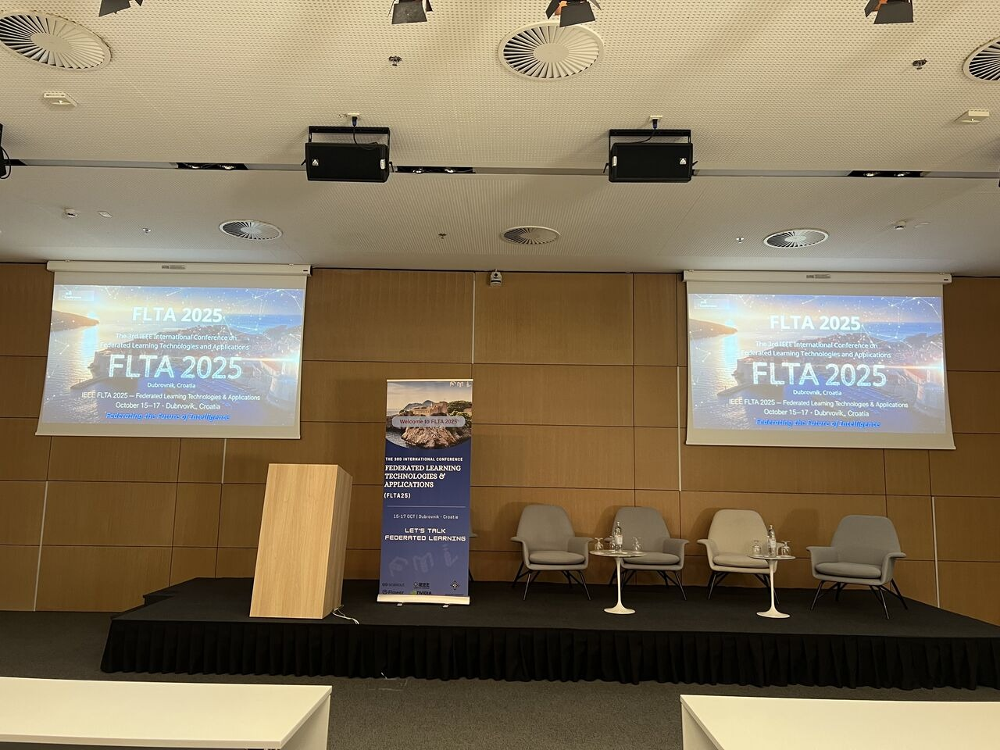

# FED-NIDS: Bio-Inspired Federated Deep Learning for Privacy-Preserving Network Intrusion Detection in IoT

> Accepted at **IEEE FLTA 2026** (4th International Conference on Federated Learning Technologies and Applications), FedSecAI workshop, Paris, 27–30 Oct 2026. Presented in session **TS-6: Security Challenges in Federated Learning**, 27 Oct 2026.

FED-NIDS is a modular framework for collaborative intrusion detection in IoT networks. It combines **federated orchestration (Flower + PyTorch)**, an **autoencoder + classifier detector**, and a **bio-inspired optimization layer** (feature, parameter and architecture search). Clients keep raw traffic local and share only model updates.

Developed from a Master's project (University of Constantine 2, 2023/2024) and extended into the camera-ready paper.



## Headline results

| Configuration | Clients | Rounds | Final accuracy | Notes |
|---|---|---|---|---|
| **Run A (main)** | 20 | 7 | **88.09%**, aggregate F1 0.8784 | 8 balanced classes, 1,349,016 evaluation observations |
| Run B (convergence) | 100 | 75 | 62.10% | Peak 83.45% at round 37, then degraded |

Per-class results (Run A, round 7) show strong detection of DDoS, Okiru, Attack and C&C-HeartBeat, but **horizontal-port-scan recall is only 0.45** and **benign precision is 0.59**. Details: [`results/`](results/) and [`docs/experiments.md`](docs/experiments.md).

## Technical summary

| Component | Choice |
|---|---|
| Orchestration | Flower (simulation, Ray), Hydra configs, W&B tracking |
| Aggregation | FedProx (proximal term, mu = 0.1) on top of sample-weighted FedAvg |
| Detector | Autoencoder (15 inputs, 32-d code) + feedforward classifier (hidden 64, 8 classes) |
| Training | Autoencoder pretraining, then federated classifier training; batch size 64 |
| Dataset | IoT-23 derivative (Aposemat Kaggle, resampled with SMOTE), 8 classes, 60/20/20 nominal split |
| Bio-inspired layer | ASSCO, ISSA-HHO, PSO-GA, GWO-ABC (feature/parameter / architecture search) |
| Hardware | Apple M1 Pro, 16 GB, Python 3.12.7, macOS 14.6.1 |

More: [`docs/architecture.md`](docs/architecture.md), [`docs/methodology.md`](docs/methodology.md).

## What is and is not claimed

Kept deliberately honest, in line with the paper:

- Results come from **simulated clients on one IoT-23-derived dataset**, single runs, no seed repetitions.
- The two runs use different settings, so they are **not** a controlled scalability comparison.
- The four bio-inspired strategies are **not ablated**; no per-module gain is claimed.
- TLS 1.3, differential privacy, and secure aggregation appear in the architecture as **intended interfaces**. No formal privacy guarantee or measured privacy attack is reported, and the thesis states full transmission encryption was not implemented.
- The 32-d encoding exceeds the 15 input features, so it is **not dimensionality reduction**.
- The 0.912 s "training time" of Run B is a **callback subtotal**, not elapsed training.

## Repository layout

```
paper/        Camera-ready IEEE FLTA 2026 paper (PDF)
thesis/       Full Master's thesis (PDF, 282 pages)
docs/         Technical write-up extracted from the thesis and paper
configs/      Run A / Run B configurations as recorded
results/      Class report, round trajectory, centralized references (CSV)
assets/
  architecture/  Global and detailed architecture figures
  conference/    Acceptance notification, program, session photos
```

## Conference evidence

| | |
|---|---|
|  |  |
| Acceptance notification (FLTA 2026 chairs) | Program: TS-6, Room 1, 16:00–17:30, paper 05 |
|  |  |
| Program at a glance | Presentation in the session room |
|  |  |
| Stage and conference signage | Group photo with attendees |

## Citation

```bibtex
@inproceedings{mallem2026fednids,
  title     = {FED-NIDS: A Bio-Inspired Federated Deep Learning Framework for Privacy-Preserving Network Intrusion Detection in IoT},
  author    = {Mallem Bourhane Eddine Islam and Boukhiar Naima and Ojwo Pius Sunday},
  booktitle = {IEEE International Conference on Federated Learning Technologies and Applications (FLTA), FedSecAI Workshop},
  year      = {2026},
  address   = {Paris, France}
}
```


